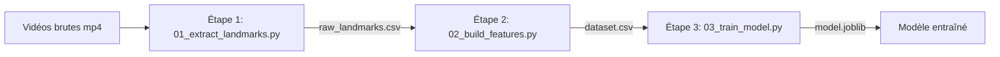

# 🏓 SpinTracker — Guide de Développement & Conception

Bienvenue dans le guide de conception et de programmation de **SpinTracker**. Ce document détaille l'architecture, la théorie sous-jacente et les étapes pas à pas pour coder toi-même l'intégralité de la pipeline de reconnaissance de coups de tennis de table.

---

## 🎯 1. Vue d'ensemble du Projet

### Le problème
Au tennis de table, la vitesse de balle et l'effet imprimé dépendent directement de la **biomécanique du geste** (trajectoire de la raquette, vitesse de la main, angle du coude, flexion du buste) :
- **Topspin** : Mouvement ascendant prononcé, forte accélération du poignet vers le haut et l'avant pour brosser la balle.
- **Poussette** : Mouvement descendant ou horizontal court, geste plus lent, ouverture de palette.
- **Bloc** : Mouvement compact d'absorption, très peu d'amplitude, accompagnement minimal.

### L'objectif
Transformer une vidéo brute contenant un coup technique en une prédiction fiable (`topspin`, `poussette`, `bloc`) grâce à :
1. La **vision par ordinateur** (extraction de squelette corporel via MediaPipe Pose).
2. L'**ingénierie de caractéristiques** (calcul de grandeurs physiques et cinématiques).
3. Le **Machine Learning tabulaire** (classification supervisée via Random Forest).

---

## 🏗️ 2. Architecture de la Pipeline

Plutôt qu'un unique script monolithique difficile à déboguer, nous découpons le projet en une pipeline modulaire en 3 étapes indépendantes :



### Organisation des dossiers

```text
SpinTracker/
├── data/
│   ├── raw_videos/            # Tes vidéos brutes classées par coup
│   │   ├── topspin/
│   │   ├── poussette/
│   │   └── bloc/
│   └── processed/             # Fichiers intermédiaires et modèles
│       ├── raw_landmarks.csv  # Squelettes frame par frame
│       ├── dataset.csv        # 1 ligne par vidéo avec features calculées
│       └── model.joblib       # Modèle IA sauvegardé
├── src/
│   ├── 01_extract_landmarks.py # Extraction MediaPipe
│   ├── 02_build_features.py    # Calcul des métriques physiques
│   ├── 03_train_model.py       # Entraînement et métriques ML
│   └── pipeline.py             # Script orchestrateur
├── requirements.txt            # Dépendances Python
├── GUIDE_DEVELOPPEMENT.md      # Ce guide
└── README.md
```

---

## ⚙️ 3. Prérequis et Environnement

### Dépendances nécessaires
- **`opencv-python`** : Lecture des flux vidéo frame par frame, redimensionnement et conversions d'espaces couleur (BGR vers RGB).
- **`mediapipe`** : Détection du squelette corporel 3D en temps réel sans GPU lourd.
- **`pandas`** : Manipulation des DataFrames et sauvegarde des jeux de données intermédiaires au format CSV.
- **`numpy`** : Calcul vectoriel (produit scalaire, normes euclidiennes, angles).
- **`scikit-learn`** : Séparation train/test, algorithme Random Forest, matrice de confusion et rapport de classification.
- **`joblib`** : Sérialisation et sauvegarde des poids du modèle sur disque.

---

## 🎬 Étape 0 : Collecte et Préparation des Vidéos

Avant de coder, la qualité du modèle dépendra de tes données :
1. **Cadrage** : Place la caméra de profil ou à 45° (3/4 face) du côté du bras dominant (droitier pour la configuration par défaut).
2. **Découpage (1 clip = 1 geste)** :
   - Début : Armé du geste (quand le bras recule ou descend).
   - Fin : Fin de l'accompagnement (quand le geste se termine).
   - Durée typique : entre 0.5 et 2 secondes par clip.
3. **Rangement** :
   - Dépose au moins 5 à 10 vidéos par classe dans `data/raw_videos/topspin/`, `data/raw_videos/poussette/`, et `data/raw_videos/bloc/`.

---

## 📐 Étape 1 : Extraction des Repères Anatomiques (`01_extract_landmarks.py`)

### 🧠 Théorie & Concepts
MediaPipe Pose détecte **33 points de repère corporels** normalisés entre $0.0$ et $1.0$ :
- $x$ : position horizontale normalisée ($0$ = bord gauche, $1$ = bord droit).
- $y$ : position verticale normalisée ($0$ = **haut** de l'image, $1$ = **bas** de l'image — attention au repère inversé !).
- $z$ : profondeur relative par rapport au centre des hanches.

Pour le tennis de table, nous n'avons pas besoin des 33 repères. Concentre-toi sur le buste et le bras dominant :
- `RIGHT_SHOULDER` (Épaule droite)
- `RIGHT_ELBOW` (Coude droit)
- `RIGHT_WRIST` (Poignet droit)
- `LEFT_SHOULDER` (Épaule gauche, utile pour l'orientation du buste)
- `RIGHT_HIP` & `LEFT_HIP` (Hanches, pour la référence basse)

### 🛠️ Ce que tu dois programmer
Ton script doit :
1. **Parcourir les dossiers** :
   - Scanner `data/raw_videos/` pour détecter chaque sous-dossier (dont le nom sert de `label`).
   - Lister tous les fichiers vidéo (`.mp4`, `.mov`, `.avi`).
2. **Lire la vidéo frame par frame** avec OpenCV :
   - `cap = cv2.VideoCapture(video_path)`
   - Lire avec `ret, frame = cap.read()` dans une boucle `while cap.isOpened()`.
   - Convertir chaque frame de BGR vers RGB : `cv2.cvtColor(frame, cv2.COLOR_BGR2RGB)`.
3. **Appliquer MediaPipe Pose** :
   - Instancier le détecteur : `with mp.solutions.pose.Pose(...) as pose:`
   - Traiter la frame : `results = pose.process(frame_rgb)`.
   - Récupérer les coordonnées si `results.pose_landmarks` existe.
4. **Enregistrer les données tabulaires** :
   - Construire un dictionnaire par frame :
     `{"video_id": ..., "label": ..., "frame_idx": ..., "R_WRIST_x": ..., "R_WRIST_y": ..., ...}`
   - Concaténer toutes les lignes dans un `pandas.DataFrame`.
   - Sauvegarder dans `data/processed/raw_landmarks.csv`.

> [!TIP]
> N'oublie pas de toujours appeler `cap.release()` pour libérer la ressource vidéo une fois la lecture terminée !

---

## 🔬 Étape 2 : Ingénierie des Caractéristiques (`02_build_features.py`)

### 🧠 Théorie & Concepts
À l'étape 1, une vidéo de 30 frames génère 30 lignes de coordonnées. Or, les algorithmes comme Random Forest attendent **une ligne fixe par exemple** (une vidéo = un vecteur de variables numériques).

Il faut transformer cette série temporelle en métriques résumées du geste :

#### 1. Déplacement vertical du poignet ($\Delta y$)
- Formule : $\Delta y = y_{\text{start}} - y_{\text{end}}$
- *Pourquoi ?* Puisque $y=0$ est en haut, si le poignet monte, $y$ diminue. Donc $(y_{\text{start}} - y_{\text{end}}) > 0$ correspond à un mouvement ascendant (typique du **topspin**).

#### 2. Déplacement horizontal du poignet ($\Delta x$)
- Formule : $\Delta x = x_{\text{end}} - x_{\text{start}}$
- Permet de mesurer l'amplitude vers l'avant.

#### 3. Vitesse maximale du poignet
- Pour chaque paire de frames consécutives $t$ et $t+1$, calculer la distance euclidienne parcourue :
  $$v_t = \sqrt{(x_{t+1} - x_t)^2 + (y_{t+1} - y_t)^2}$$
- La vitesse max est $\max(v_t)$. Le topspin présente une accélération explosive à l'impact, contrairement au bloc.

#### 4. Angles articulaires (Angle du coude)
- Soient trois points dans le plan 2D : Épaule ($A$), Coude ($B$), Poignet ($C$).
- Le coude est le sommet $B$. Les vecteurs sont :
  $$\vec{u} = A - B \quad \text{et} \quad \vec{v} = C - B$$
- L'angle $\theta$ en radians est donné par la définition du produit scalaire :
  $$\cos(\theta) = \frac{\vec{u} \cdot \vec{v}}{\|\vec{u}\| \|\vec{v}\|}$$
  $$\theta_{\text{degrés}} = \arccos(\text{clip}(\cos(\theta), -1.0, 1.0)) \times \frac{180}{\pi}$$
- On extrait ensuite l'angle minimum (`elbow_angle_min`) et maximum (`elbow_angle_max`) au cours du geste.

#### 5. Durée du geste
- Nombre total de frames où le joueur a été détecté (`len(group)`).

### 🛠️ Ce que tu dois programmer
1. Charger `data/processed/raw_landmarks.csv`.
2. Grouper les données par vidéo : `df.groupby("video_id")`.
3. Trier chaque groupe par `frame_idx`.
4. Calculer les 6 caractéristiques pour chaque geste.
5. Construire un nouveau DataFrame contenant 1 ligne par vidéo et l'enregistrer dans `data/processed/dataset.csv`.

---

## 🤖 Étape 3 : Entraînement du Modèle (`03_train_model.py`)

### 🧠 Théorie & Concepts
Pourquoi un **Random Forest** ?
- Très performant sur les données tabulaires avec peu d'exemples.
- Ne nécessite pas de normalisation stricte des variables (contrairement aux SVM ou réseaux de neurones).
- Fournit l'importance des variables (permet d'analyser quelle métrique physique distingue le mieux un topspin d'un bloc).

### 🛠️ Ce que tu dois programmer
1. **Chargement et séparation $X$ et $y$** :
   - $X$ : colonnes de features (`wrist_delta_y`, `wrist_max_velocity`, `elbow_angle_min`, etc.).
   - $y$ : colonne cible (`label`).
2. **Découpage Train / Test (`train_test_split`)** :
   - Utiliser `test_size=0.25` ou `0.20`.
   - Utiliser `stratify=y` pour conserver les mêmes proportions de classes dans le jeu d'entraînement et de test.
3. **Instanciation et ajustement** :
   - `clf = RandomForestClassifier(n_estimators=100, random_state=42)`
   - `clf.fit(X_train, y_train)`
4. **Évaluation** :
   - Calculer les prédictions : `y_pred = clf.predict(X_test)`
   - Afficher `classification_report(y_test, y_pred)` (Precision, Recall, F1-score).
   - Afficher la `confusion_matrix(y_test, y_pred)`.
5. **Sauvegarde** :
   - Exporter le modèle avec `joblib.dump(clf, "data/processed/model.joblib")`.

---

## 🎼 Étape 4 : L'Orchestrateur (`pipeline.py`)

### 🧠 Bonnes pratiques
L'orchestrateur exécute la chaîne en une seule commande :
```powershell
python src/pipeline.py
```

> [!NOTE]
> **Piège syntaxique en Python :**
> En Python, un nom de fichier débutant par un chiffre (ex: `01_extract_landmarks.py`) ne peut pas être importé avec `import 01_extract_landmarks` (erreur de syntaxe sur le chiffre).
> Pour l'importer proprement, utilise la bibliothèque standard `importlib` :
> ```python
> import importlib
> extract_mod = importlib.import_module("01_extract_landmarks")
> extract_mod.run_extraction()
> ```

---

---

## 🏓 Étape 5 : L'Analyse Complète de Match (`src/match_analyzer.py`)

### 🧠 Théorie & Défis Techniques

Analyser un match réel de 10 à 30 minutes avec 2 joueurs pose des problématiques bien plus complexes que classifier un clip isolé :

#### 1. Identification du Joueur & Changement de Côté à chaque Set
Dans un match officiel de tennis de table :
- Il y a **2 joueurs** filmés en permanence.
- Les joueurs **changent de côté à la fin de chaque set** (par exemple, Joueur A commence au premier plan, puis passe au fond de court au set 2, revient au premier plan au set 3, etc.).
- **À la manche décisive**, ils permutent également dès que le premier joueur atteint **5 points**.

**Stratégie de suivi du joueur sélectionné :**
1. **Initialisation** : L'utilisateur déclare sa position de départ (`near` = premier plan / `far` = fond de court) ou sa couleur de tenue.
2. **Signature visuelle (Color Re-ID)** :
   - On extrait la boîte englobante du torse du joueur (entre épaules et hanches).
   - On calcule l'histogramme de couleur (espace HSV) de son maillot.
   - Cette empreinte colorimétrique permet de revalider l'identité du joueur même après un temps mort ou un déplacement hors champ.
3. **Détection des transitions de set** :
   - Les sets sont séparés par un temps mort prolongé (> 30 à 60 secondes d'inactivité sur la table).
   - Les deux joueurs changent de côté en marchant autour de la table.
   - L'algorithme bascule automatiquement l'assignation du côté pour le set suivant.

---

#### 2. Séquençage des Échanges (Rally Engine)
Chaque échange (rallye) suit un cycle de vie précis :
1. **Service** : Amorçage du point, balle mise en jeu.
2. **Échange actif** : Alternance des frappes (Joueur 1 $\leftrightarrow$ Joueur 2).
3. **Fin de point** : Arrêt du mouvement de la balle sur la table, temps mort avant le service suivant.

---

#### 3. Logique de Qualification des Coups (Réussi, Faute, Winner)
Pour chaque coup exécuté par notre joueur :

```mermaid
flowchart TD
    A[Coup joué par notre joueur] --> B{L'adversaire rejoue-t-il ?}
    B -- Oui --> C[Coup Réussi (In-Play)]
    B -- Non --> D{Qui marque le point ?}
    D -- Notre Joueur --> E[🏆 Point Gagnant / Winner]
    D -- Adversaire --> F[❌ Faute Directe]
```

- **Coup Réussi (`success`)** :
  - Le coup franchit le filet, rebondit sur la table adverse et l'adversaire effectue un coup de renvoi. L'échange continue.
- **Point Gagnant / Winner (`winner`)** :
  - Le coup est le dernier coup valide joué par notre joueur.
  - L'adversaire est pris de vitesse, ne touche pas la balle ou commet une faute directe immédiate en tentant de la remettre.
  - Le point est attribué à notre joueur.
- **Faute Directe (`unforced_error`)** :
  - Le coup heurte le filet ou sort directement de la table sans que l'adversaire n'ait eu à jouer.
  - Le point est perdu.

---

### 📊 Tableau Statistique Produit

Le moteur calcule et structure les données sous ce format JSON normalisé :

```json
{
  "summary": {
    "total_points": 48,
    "points_won": 26,
    "points_lost": 22,
    "win_rate": 54.2
  },
  "strokes_breakdown": [
    {
      "stroke": "TopSpin",
      "total": 34,
      "successful": 28,
      "success_rate": 82.4,
      "unforced_errors": 6,
      "error_rate": 17.6,
      "winners": 11,
      "winner_rate": 32.4
    },
    {
      "stroke": "Bloc",
      "total": 12,
      "successful": 9,
      "success_rate": 75.0,
      "unforced_errors": 3,
      "error_rate": 25.0,
      "winners": 4,
      "winner_rate": 33.3
    },
    {
      "stroke": "Poussette",
      "total": 18,
      "successful": 17,
      "success_rate": 94.4,
      "unforced_errors": 1,
      "error_rate": 5.6,
      "winners": 2,
      "winner_rate": 11.1
    }
  ],
  "sets": [
    { "set_number": 1, "player_side": "near", "points_won": 11, "points_lost": 8, "strokes": [...] },
    { "set_number": 2, "player_side": "far", "points_won": 9, "points_lost": 11, "strokes": [...] }
  ],
  "rallies": [...]
}
```

---

## 🚀 Pistes d'Amélioration & Évolutions Futures

- [x] **Analyse complète de match à 2 joueurs** avec séquençage des points.
- [x] **Prise en compte des changements de côté entre les sets**.
- [x] **Comptabilisation des points gagnants (Winners) et fautes directes par coup**.
- [ ] **Détection précise de l'impact de la balle sur la table** avec un modèle YOLO-Ball haute vitesse (120/240 fps).
- [ ] **Carte thermique (Heatmap) des zones d'impact de balle** sur la demi-table adverse.
- [ ] **Export de rapport PDF officiel de match** pour l'entraîneur et le joueur.

